<p align="center">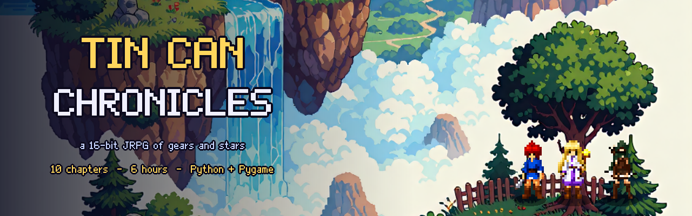</p>

# Tin Can Chronicles

A tiny **Chrono Trigger–style JRPG** in Python + Pygame, presented in a
**16-bit console style**: bitmap pixel font and gradient windows, shaded
map tiles, painted battle backdrops, and SNES-flavoured synth music.

Art comes from three places:

- `input/` – character pixel art (party, Elder Bram, Scrapling) and, in
  `input/new/`, the chibi NPC sheets and the title-screen scene. These are
  cut out and downsampled at startup by `sprites.py`.
- `input/enemies/` – battle sprites for every enemy and boss, generated
  with the local IGSimple image API and cut out / downsampled at startup
  (a detailed 3x battle version and a small map version of each).
- `input/battle/` – one battle backdrop per area, generated with the local
  IGSimple image API (`kreamerge/Neutrino_v2_base_fp8_svd`) and pixelated
  to the game's 320×176 grid at load time.
- Everything else (tiles in `tiles16.py`, props, UI, music and SFX
  in `audio.py`) is generated in code. If an `input/` image is missing the
  game falls back to a procedural version.

There is **no build step**. Rendered songs are cached in
`~/.cache/tincan_chronicles/audio/` (delete it to force a re-render).

 · runs on **Linux** &
**Windows** · single window, 960×528 · saves to `~/.tincan_chronicles_save.json`

## Screenshots

<p align="center">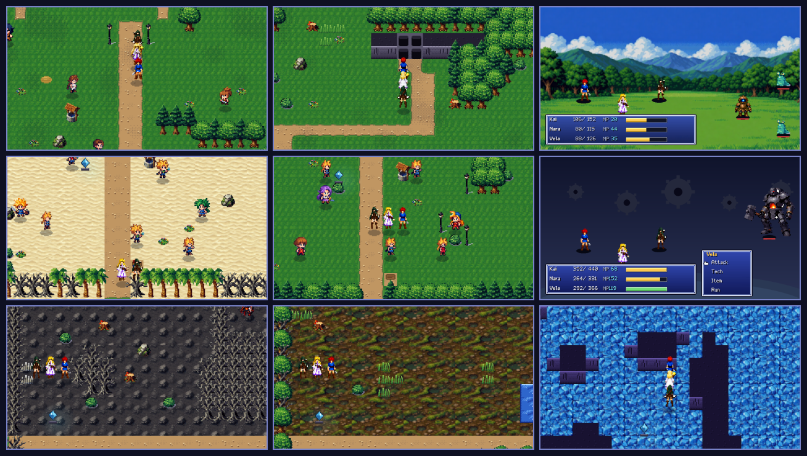</p>

| Side-view battles | Boss fights | Chapter cards |
|:---:|:---:|:---:|
| 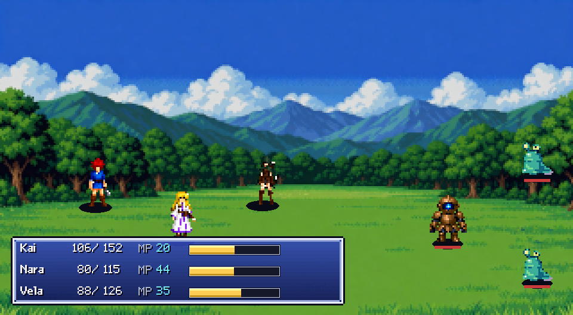 | 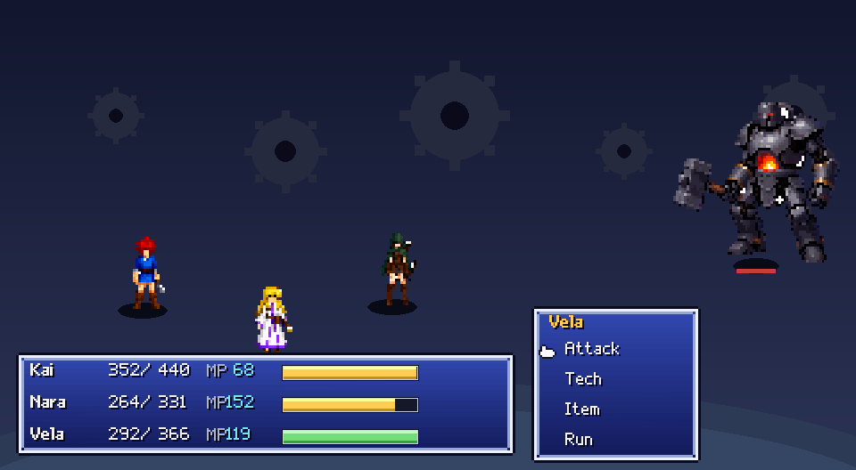 | 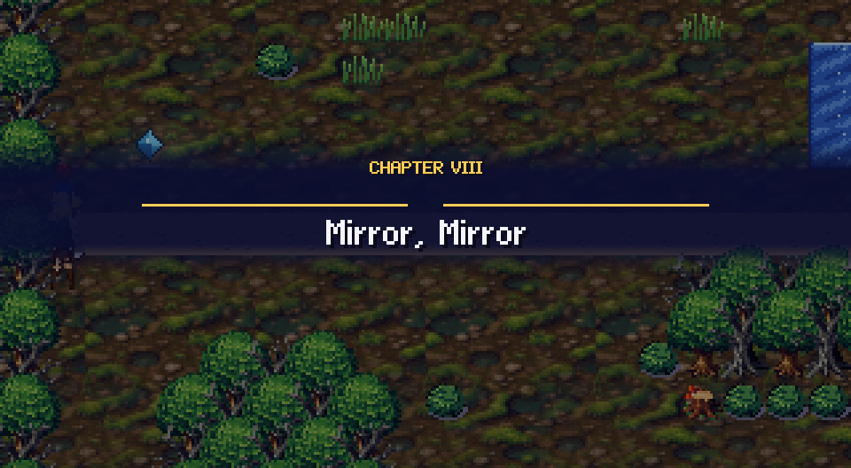 |
| **Story scenes** | **Thornwood** | **Gearhaven** |
| 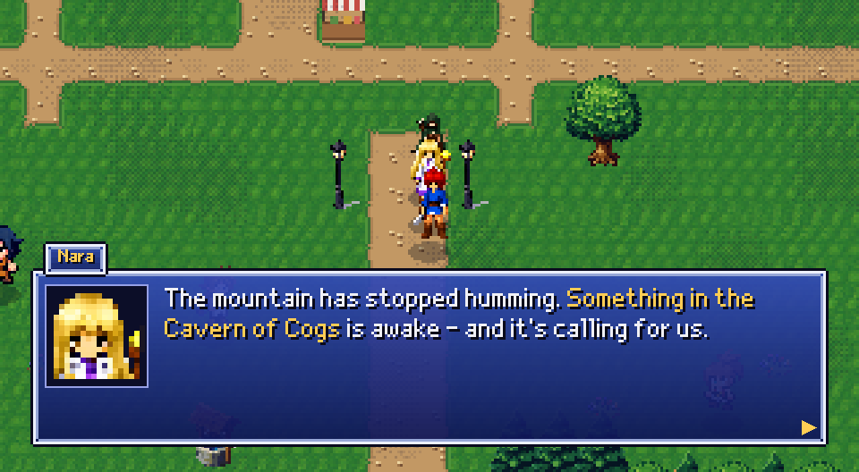 | 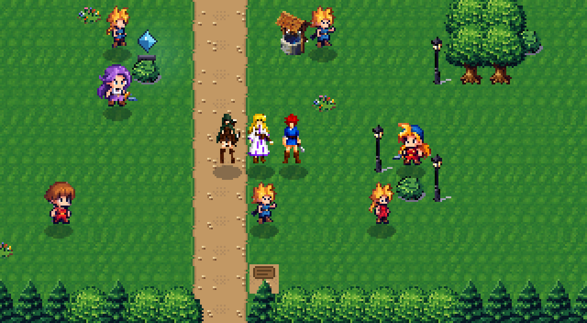 | 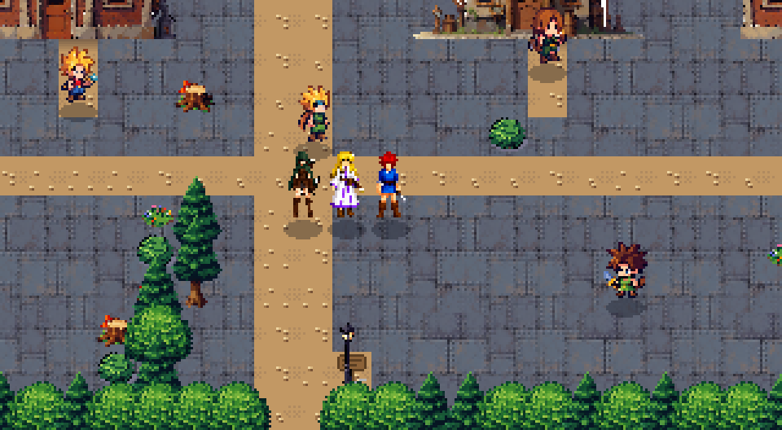 |
| **Cinderhollow** | **The Rust Dunes** | **The Astral Orrery** |
| 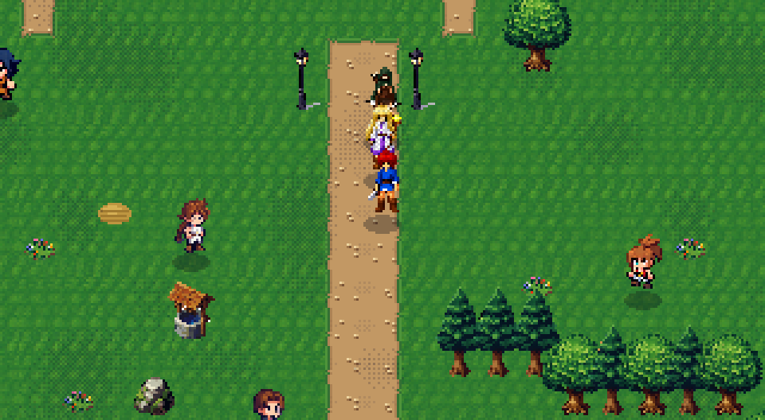 | 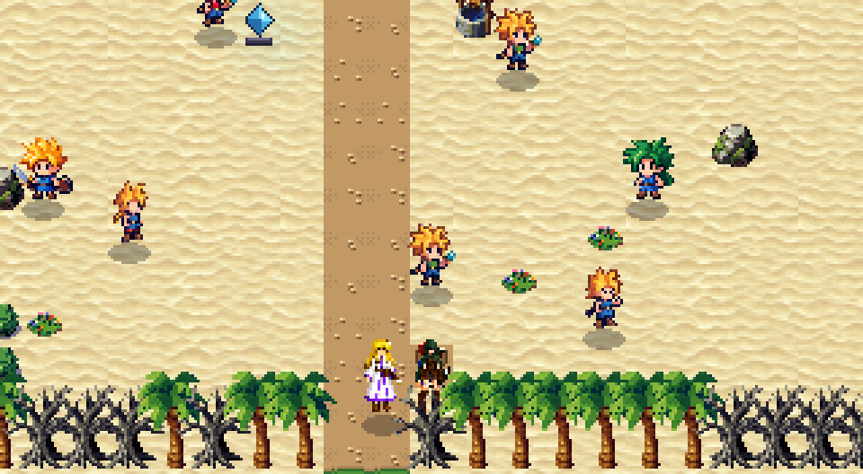 | 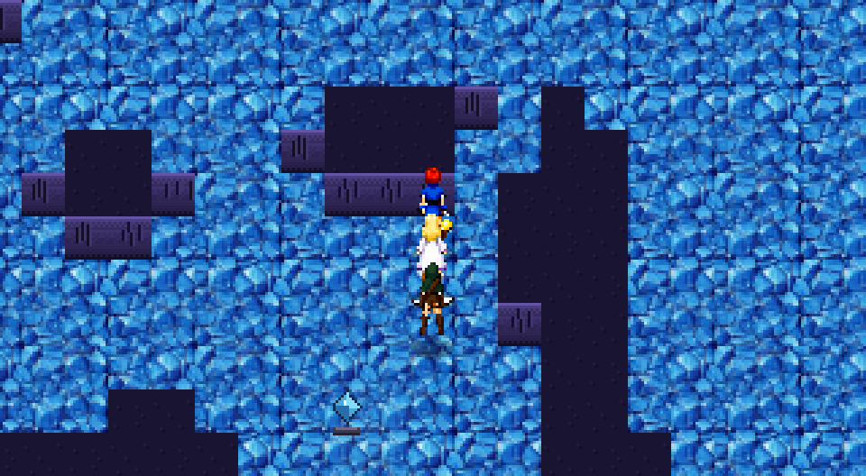 |

Screenshots are rendered from the real game by `scripts/promo.py`
(re-run it after art changes).

## Story & length

Ten chapters. Act I (chapters 1-4): the Gearlord, Captain Rusthook, the
Rime Colossus and Archon Prime. Act II (chapters 5-10, built in
`chapters.py` with `mapgen.py`): five southern regions - the Rust Dunes,
Thornwood, the Ashen Slopes, Mirror Marsh and Gearhaven - each with a town,
a field, a four-floor dungeon, a boss and four side quests, then the
six-floor Astral Orrery and the Clockmaker.

After Archon Prime falls, a masked figure appears over Emberport's
harbour: **the Clockmaker**, who needs five Star Gears to make his Orrery
chime and stop time. Each Star Gear holds a memory of his. Seen one after
another, they show a grieving father, the daughter he lost, and an
apprentice from Cinderhollow who left home thirty years ago.

The hand-written script lives in `story.py`:

- **Chapter title cards** that sweep in at the start of each chapter.
- **One-shot scenes** for arriving in each region, town and dungeon, and
  after each boss.
- **Leaders and townsfolk:** a voice of its own for every Act II town
  leader, plus two named townsfolk per town whose lines change once their
  region is saved.

Dialogue shows the speaker's name on a nameplate, and party members get a
portrait.

`scripts/playthrough.py` plays the whole story through key presses; a full
run takes about 3h20m of bot play (a first-time human player: roughly
5-7 hours).

## Features

- **Party of 3** (Kai / Nara / Vela) with the classic *follow-the-leader*
  conga line
- **Active Time Battle** (Wait mode) with Attack / Tech / Item / Run
- **Techs per character** (Ember Slash, Mend, Napalm Rain, …) learned by level
- **Level-ups**, EXP curve, equipment (weapons & charms, auto-equips upgrades)
- **A full quest**: talk to Elder Bram → cross the Cinder Road → clear the
  Cavern of Cogs → defeat **GEARLORD VX** → collect your reward
- Random encounters in tall grass, roaming monsters in the dungeon,
  treasure chests, signposts, save crystals, a shop, NPC dialogue that
  changes with quest progress
- Pause menu (Items / Status / Quest / Save), save & continue
- Procedural 16-bit style soundtrack (lead, strings, bass, bells, drums,
  echo) for every area, plus SFX

## Controls

| Key | Action |
| --- | --- |
| Arrow keys / WASD | Move |
| `Z` (or `Return`) | Confirm / talk / advance dialogue |
| `X` | Cancel |
| `C`, `Tab` or `Esc` | Open menu |
| `M` | Mute/unmute audio |

## Running the game

### Linux

```bash
# with the bundled helper (creates .venv if needed):
./run.sh

# or manually:
python3 -m venv .venv
.venv/bin/pip install pygame
.venv/bin/python main.py
```

### Windows

```bat
:: with the bundled helper (creates .venv if needed):
run.bat

:: or manually:
python -m venv .venv
.venv\Scripts\pip install pygame
.venv\Scripts\python main.py
```

Requirements: **Python 3.9+** and **pygame 2.x** (`pip install pygame`).
No other dependencies.

## Development tools

```bash
scripts/check_maps.py     # renders all maps to /tmp/tcc_art + validates data
scripts/autoplay.py       # headless integration test: plays through the game
scripts/playthrough.py    # bot plays all four chapters, reports play time
scripts/test_boss.py      # headless boss-battle + save/load test
scripts/screenshots.py    # dumps gameplay screenshots to /tmp/tcc_shots
scripts/render_check.py   # dumps sprite sheets for art QA
main.py --smoke           # run N headless frames (default 300), then quit
```

All dev scripts run headless (`SDL_VIDEODRIVER=dummy`), so they work on
CI machines without a display.

## Game map

`town` → `elder_home` (quest + save crystal) / `shop` (items & gear)
→ `overworld` (random encounters, save-crystal… no, crystals are in homes
and the cavern) → `cavern` (chests, roaming monsters, GEARLORD VX boss
and its reward chest).

## License

Do whatever you like with it (public domain).
